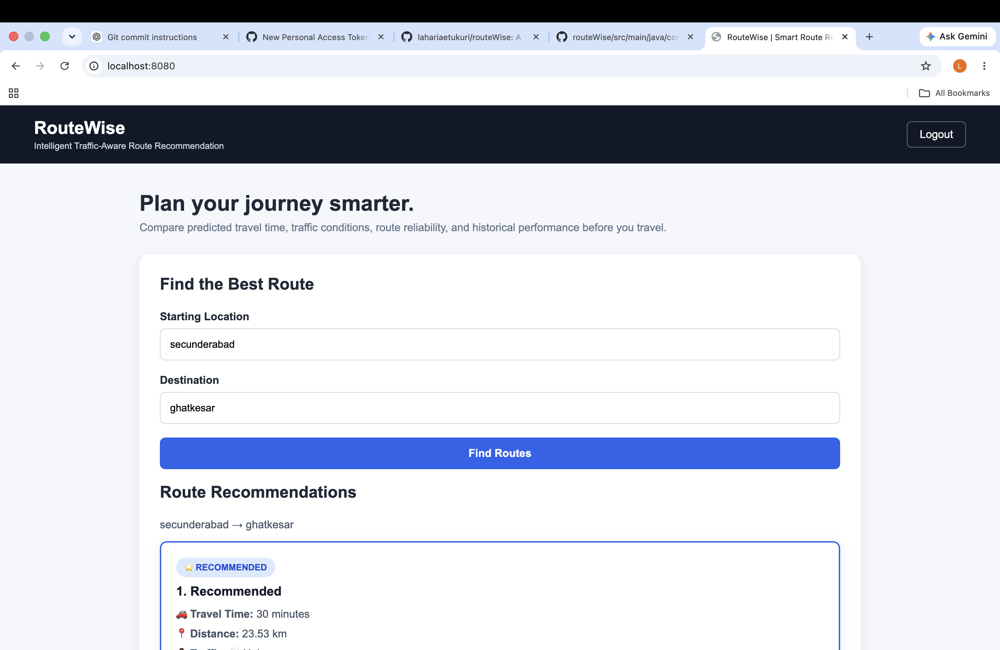
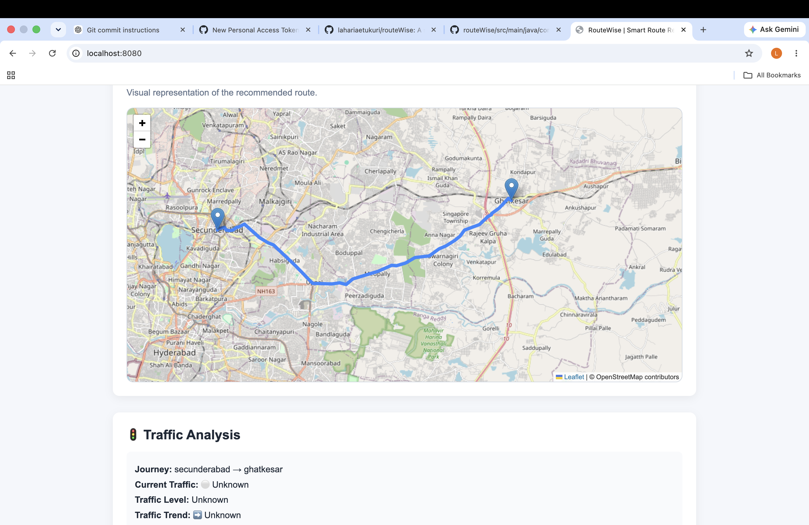
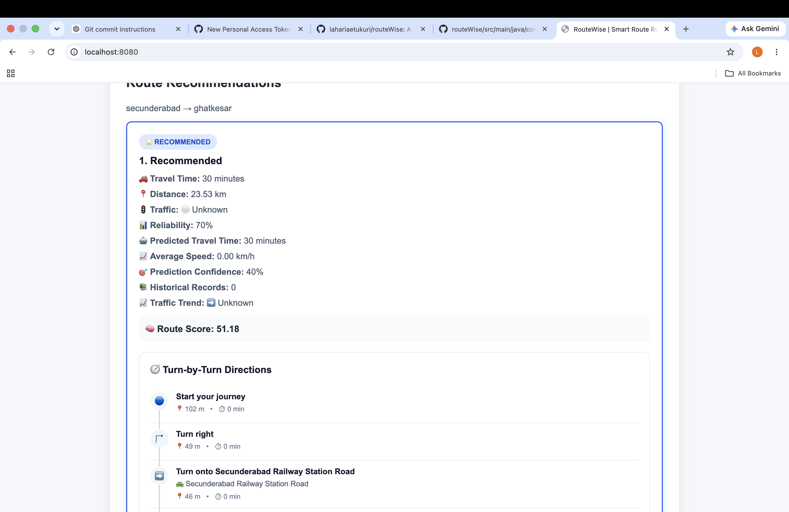
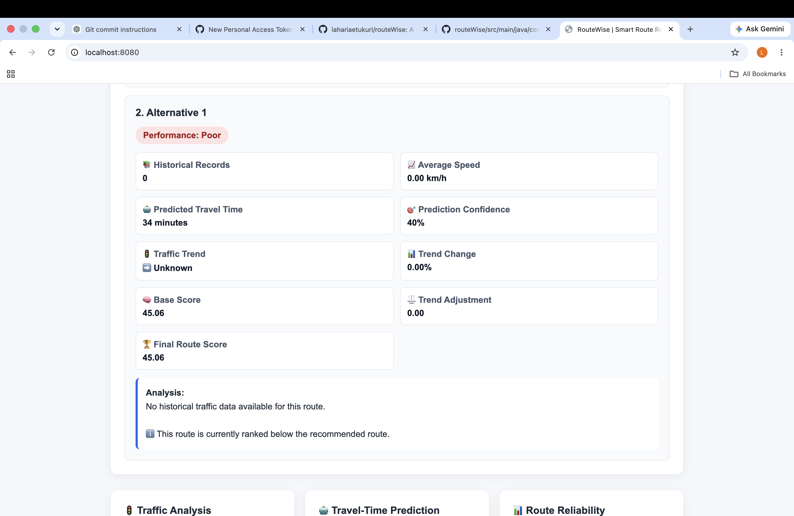
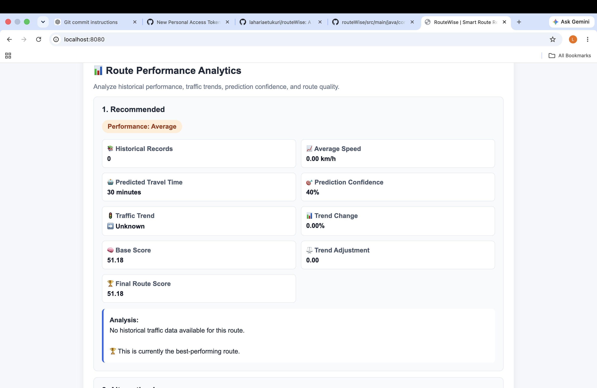
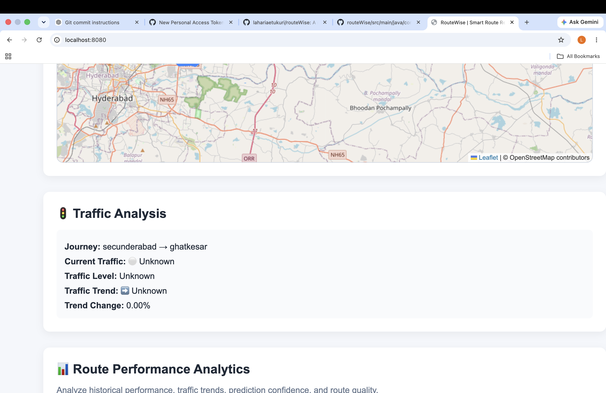

# routeWise

## Smart Route Recommendation System

routeWise is a full-stack Java web application that recommends routes based on traffic conditions and historical travel data, rather than considering distance alone.

The project was inspired by a common travel problem: the shortest route is not always the fastest route. routeWise analyzes available route information and historical traffic patterns to help users choose a more reliable route.

## Problem Statement

When traveling between two locations, navigation applications may provide multiple routes with different distances and estimated travel times.

However, choosing a route only because it is shorter can sometimes result in a longer journey due to traffic congestion.

For example, a route from Hitech City to Ghatkesar may have a shorter distance but can take longer because of heavy traffic.

routeWise aims to solve this problem by considering:

* Route distance
* Traffic conditions
* Historical traffic data
* Estimated travel time
* Traffic trends
* Route reliability

## Features

* User registration and login
* Route search between source and destination
* Traffic-aware route recommendations
* Historical traffic analysis
* Estimated travel time
* Traffic trend analysis
* Route reliability and prediction confidence
* User feedback
* User management
* Trip management
* REST APIs
* Spring Security authentication
* ## Screenshots

### Login Page



### Map



### Route Results



### Route Results - Alternative View



### Route Performance



### Traffic Analysis




## Tech Stack

### Backend

* Java
* Spring Boot
* Spring MVC
* Spring Data JPA
* Spring Security
* Hibernate

### Database

* MySQL

### Frontend

* HTML
* CSS
* JavaScript

### Development Tools

* IntelliJ IDEA
* MySQL Workbench
* Maven
* Git
* GitHub

## Project Architecture

The project follows a layered architecture:

```text
Controller
    ↓
Service
    ↓
Repository
    ↓
Database
```

### Main Layers

**Controller**

Handles HTTP requests and exposes REST endpoints.

**Service**

Contains the application's business logic, including route recommendation and traffic analysis.

**Repository**

Handles communication with the MySQL database using Spring Data JPA.

**Entity**

Represents database tables such as users, routes, trips, traffic data, predictions and feedback.

**DTO**

Used for transferring data between different layers of the application.

**Mapper**

Converts entities to DTOs and vice versa.

## Route Recommendation Logic

routeWise evaluates route information using factors such as:

1. Historical traffic data
2. Average speed
3. Estimated travel time
4. Traffic level
5. Reliability
6. Traffic trend
7. Prediction confidence

The system then calculates a score for available routes and recommends the more suitable option.

Traffic conditions are categorized as:

```text
Low
Moderate
Heavy
```

## Project Structure

```text
routeWise/
│
├── src/
│   ├── main/
│   │   ├── java/
│   │   │   └── com/routewise/routewise/
│   │   │       ├── config/
│   │   │       ├── controller/
│   │   │       ├── dto/
│   │   │       ├── entity/
│   │   │       ├── exception/
│   │   │       ├── mapper/
│   │   │       ├── repository/
│   │   │       └── service/
│   │   │
│   │   └── resources/
│   │       └── static/
│   │           ├── home.html
│   │           ├── index.html
│   │           ├── login.html
│   │           └── register.html
│   │
│   └── test/
│
├── pom.xml
├── .gitignore
├── mvnw
└── README.md
```

## Getting Started

### Prerequisites

Make sure you have installed:

* Java JDK
* Maven
* MySQL
* IntelliJ IDEA

### Clone the Repository

```bash
git clone https://github.com/lahariaetukuri/routeWise.git
cd routeWise
```

### Configure the Database

Create a MySQL database for the project and configure your database connection in the Spring Boot configuration.

Do not commit database passwords or other sensitive credentials to GitHub.

### Run the Application

Using Maven:

```bash
./mvnw spring-boot:run
```

Or run the main Spring Boot class from IntelliJ IDEA.

## Application

Once the application is running, open:

```text
http://localhost:8080
```

## Example API

Route recommendation can be requested using:

```text
GET /api/routes
```

Example:

```text
/api/routes?source=Hitech%20city&destination=ghatkesar
```

The API returns route information including factors such as distance, estimated time and traffic-related recommendations.

## Future Enhancements

* Real-time traffic API integration
* Machine-learning-based travel-time prediction
* Live GPS tracking
* Interactive map integration
* Weather-aware route recommendations
* User-specific route preferences
* Mobile application
* More advanced historical traffic analysis

## Author

**Lahari Aetukuri**

B.Tech – Computer Science and Engineering

## Project Goal

The goal of routeWise is to make route selection smarter by considering more than just distance, helping users make better travel decisions based on traffic and historical patterns.
